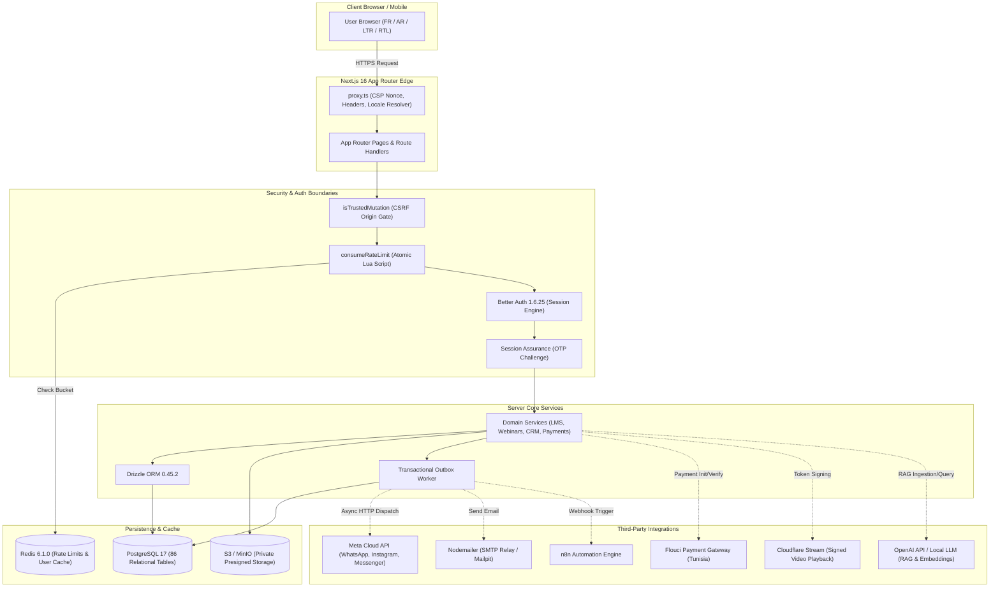
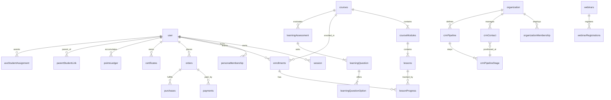

# PROJECT_CONTEXT.md — Comprehensive Architectural & Technical Analysis

**Document Target:** Full Architectural Context for Autonomous AI Engineering Agents  
**Target Repository:** `anei-platform-production-v3.3.0` (`anei-academy-platform`)  
**Repository Version:** 3.4.0 [VERIFIED: `package.json`]  
**Analysis Date:** September 2026 [VERIFIED: `git log`]  
**Author:** Senior Software Architect (Autonomous Analysis)  
**Classification Rules:** All statements are tagged as `[VERIFIED]` (derived directly from code inspection), `[INFERRED]` (deduced from code patterns and conventions), or `[UNKNOWN]` (unverifiable from repository alone; requires owner confirmation). Secrets, passwords, API tokens, connection strings, and PII have been completely omitted; environment variables are cited by variable NAME only.

---

## 1. Executive Summary

[VERIFIED: `package.json`, `README.md`, `design-system/anei/MASTER.md`]
**Académie Nationale de l’Éducation Inclusive (ANEI) — الأكاديمية الوطنية للتربية الدامجة** is a production-grade, bilingual French/Arabic web platform dedicated to professional training, pedagogical guidance, and clinical coordination in inclusive education across the Tunisian and broader MENA market.

[VERIFIED: `src/server/db/schema.ts`, `src/modules/personas/domain/permissions.ts`]
The platform solves a acute structural challenge: coordinating educators, certified school assistants (Auxiliaires de Vie Scolaire — AVS), parents, clinical specialists (speech therapists, psychologists), and institutional school administrations around neurodivergent and special-needs students within a single secure ecosystem.

[VERIFIED: `src/server/env.ts`, `drizzle/0000_initial.sql`]
Functionally, ANEI combines:
1. A public institutional editorial site and public AVS directory.
2. A learner Learning Management System (LMS) with lesson checkpoints, video streaming, quizzes, and certificates.
3. An administrative back-office with granular role-based permissions, audit logging, and financial reconciliation.
4. An organization-scoped CRM with multi-channel messaging (WhatsApp, Instagram, Messenger) and appointment scheduling.

[VERIFIED: `package.json`, `SECURITY_FIXES.md`]
**Current Version and Maturity:** The repository is at version **3.4.0** and has achieved **late-stage production readiness**. All core subsystems (authentication, authorization, database migrations, security origin validation, rate limiting, and automated test suites) are functional and passing in production configuration. External third-party credentials (production SMTP, Flouci commercial keys, Meta Cloud credentials, and S3 production buckets) remain to be provisioned by the operational owner before formal DNS go-live [VERIFIED: `src/server/env.ts`, `docs/PRODUCTION_CHECKLIST.md`].

---

## 2. Product Objectives and Users

### 2.1 Mission and Business Goals
[VERIFIED: `README.md`, `design-system/anei/MASTER.md`, `src/lib/i18n.ts`]
- **Core Mission:** Institutionalize and democratize inclusive education through certified professional training, pedagogical resources, and direct parent-school-specialist coordination.
- **Slogan:** *"Former, accompagner, inclure — نتكوّن، نرافق، ندمج"* [VERIFIED: `src/lib/i18n.ts`].
- **Market Focus:** Tunisia and North Africa / MENA region [VERIFIED: `src/lib/i18n.ts`, `src/lib/tunisia-locations.ts`].
- **Business Goal:** Monetize high-value pedagogical training for educators and institutions, issue verifiable credentials, provide a verified matching directory for AVS professionals, and operate an administrative CRM for school admissions and clinical appointments [VERIFIED: `src/server/services/checkout.ts`, `src/server/services/certificates.ts`].

### 2.2 User Types, Personas, and Security Roles
[VERIFIED: `src/server/auth/index.ts`, `src/modules/admin/domain/permissions.ts`, `src/modules/personas/domain/permissions.ts`]

The platform enforces a two-tier identity model:
1. **Security Role (`user.role`):** Evaluated strictly by server authorization guards (`USER`, `ADMIN`, `SUPER_ADMIN`).
2. **Product Persona (`persona_membership.persona`):** Dictates portal routing, workspace features, and domain relationships (`STUDENT`, `TEACHER`, `AVS`, `PARENT`, `SPECIALIST`, `ORGANIZATION`). A user holds one primary persona and may hold secondary memberships [VERIFIED: `src/server/services/personas.ts`].

| Persona / Role | Target User | Portal Route | Default Status | Permissions & Enforcement Mechanisms |
| :--- | :--- | :--- | :--- | :--- |
| **GUEST** [VERIFIED: `src/app/[locale]/(site)/`] | Public visitors, prospective learners | `/`, `/formations`, `/webinaires`, `/avs` | Unauthenticated | Public catalog browsing, guest webinar registration via signed access code, contact messages [VERIFIED: `src/lib/webinars.ts`]. |
| **STUDENT** [VERIFIED: `src/app/[locale]/(learner)/dashboard`] | Regular learners, educators taking courses | `/[locale]/dashboard` | `ACTIVE` | Course enrollment, video checkpoints, quizzes, certificate downloads, reward points redemption [VERIFIED: `src/server/services/learning-assessments.ts`]. |
| **TEACHER** [VERIFIED: `src/app/[locale]/(site)/teacher`] | School teachers & trainers | `/[locale]/teacher` | `PENDING_REVIEW` | Assigned course progress tracking (`teacher_course_assignment`), student roster visibility, teaching profile [VERIFIED: `src/server/queries/personas.ts`]. |
| **AVS** [VERIFIED: `src/app/[locale]/(site)/avs/espace`] | School Life Assistants (Auxiliaires de Vie Scolaire) | `/[locale]/avs/espace` | `PENDING_REVIEW` | Assigned student tracking (`avs_student_assignment`), professional profile in directory, intervention logging [VERIFIED: `src/server/services/relationships.ts`]. |
| **PARENT** [VERIFIED: `src/app/[locale]/(site)/parent`] | Parents of special-needs children | `/[locale]/parent` | `ACTIVE` | Child linkage (`parent_student_link`), view child enrollments/progress, book clinical appointments [VERIFIED: `src/server/queries/personas.ts`]. |
| **SPECIALIST** [VERIFIED: `src/app/[locale]/(site)/specialist`] | Speech therapists, psychologists, psychomotor specialists | `/[locale]/specialist` | `PENDING_REVIEW` | Clinical evaluations, assigned student tracking (`specialist_student_assignment`), appointment schedule management [VERIFIED: `src/server/services/appointments.ts`]. |
| **ORGANIZATION** [VERIFIED: `src/app/[locale]/(site)/organization`] | Schools, institutions, specialized centers | `/[locale]/organization` | `PENDING_REVIEW` | Member directory (`organization_membership`), cohort assignments, admissions, org-scoped CRM [VERIFIED: `src/server/services/organizations.ts`]. |
| **ADMIN** [VERIFIED: `src/app/[locale]/admin`] | Academy operations & support staff | `/[locale]/admin` | Enforced by `user.role` | 33 granular permissions; manages courses, webinars, CRM, orders, payments, audit logs [VERIFIED: `src/modules/admin/domain/permissions.ts`]. |
| **SUPER_ADMIN** [VERIFIED: `src/app/[locale]/admin`] | Platform executives & lead architects | `/[locale]/admin` | Enforced by `user.role` | All 36 admin permissions, including `users.role.change`, `courses.delete`, and `ai.knowledge.manage` [VERIFIED: `src/modules/admin/domain/permissions.ts`]. |

### 2.3 Business Model & Pricing Logic
[VERIFIED: `src/server/db/schema.ts`, `src/lib/i18n.ts`, `src/server/services/checkout.ts`, `src/server/services/payments.ts`]
- **Currency:** Tunisian Dinar (`TND`), internally computed and stored in **millimes** (`priceMillimes`: integer, where 1 TND = 1,000 millimes) [VERIFIED: `src/lib/i18n.ts`, `src/server/db/schema.ts`].
- **Monetized Assets:**
  - Individual course purchases [VERIFIED: `courses.priceMillimes`].
  - Paid webinars [VERIFIED: `webinars.priceMillimes`].
  - Downloadable pedagogical resource packages [VERIFIED: `resources.priceMillimes`].
  - Reward redemption catalog via gamified points [VERIFIED: `pointsLedger`, `rewardItem`].
- **Payment Providers:**
  - **Flouci:** Tunisian digital wallet and bank card payment gateway [VERIFIED: `src/server/services/payments.ts`].
  - **ClicToPay:** Tunisian national interbank switch (SMT); adapter currently stubbed and fails closed in production [VERIFIED: `src/server/env.ts`].
  - **Mock Gateway:** Development and isolated staging only (`ANEI_DEPLOYMENT_ENV=staging`); strictly prohibited in production [VERIFIED: `src/server/env.ts`].

### 2.4 Languages, Locales, and RTL
[VERIFIED: `src/lib/i18n.ts`, `src/proxy.ts`, `src/app/[locale]/layout.tsx`]
- **Supported Locales:** French (`fr`) and Arabic (`ar`) are primary production locales with full parity [VERIFIED: `src/lib/i18n.ts`]. English (`en`) is defined in `locales` array but has partial page translations [VERIFIED: `src/lib/i18n.ts`].
- **RTL Support:** Native right-to-left layout switches automatically when `locale === 'ar'` (`dir="rtl"`, `lang="ar"`). Typography stacks adapt dynamically: `Inter` for Latin scripts and `Noto Sans Arabic` for Arabic [VERIFIED: `src/app/globals.css`, `design-system/anei/MASTER.md`].

---

## 3. Feature Inventory

[VERIFIED: Survey across `src/app/`, `src/server/services/`, `src/modules/`, and `tests/`]

| Feature Subsystem | User-Facing Description | Main Files | Implementation Status | Test Coverage |
| :--- | :--- | :--- | :--- | :--- |
| **Authentication & Sessions** | Email/password sign-up, login, Google OAuth, session assurance, email verification, password reset | `src/server/auth/index.ts`, `src/server/auth/session.ts`, `src/server/auth/assurance.ts`, `src/app/api/auth/[...all]/route.ts` | Complete | Yes [VERIFIED: `tests/security/auth-hardening.test.ts`] |
| **Persona Profiles & Portals** | Persona onboarding wizard, profile completeness, role-based dashboards | `src/server/services/personas.ts`, `src/components/auth/CompleteProfileForm.tsx`, `src/app/[locale]/(site)/[persona]/` | Complete | Yes [VERIFIED: `tests/integration/persona-profiles.test.ts`] |
| **Course Catalog & Search** | Public course list, category filters, difficulty level, search queries, slug lookup | `src/server/queries/catalog.ts`, `src/app/[locale]/(site)/formations/page.tsx`, `src/components/sections/CatalogGrid.tsx` | Complete | Yes [VERIFIED: `tests/unit/home-query-contract.test.ts`] |
| **LMS Player & Modules** | Sticky curriculum sidebar, video player, lesson progress tracking, completion status | `src/app/[locale]/(learner)/apprendre/[slug]/page.tsx`, `src/server/services/lms.ts`, `src/app/api/progress/route.ts` | Complete | Yes [VERIFIED: `tests/e2e/course-room.spec.ts`] |
| **Video Checkpoints** | In-video knowledge verification questions pausing lesson playback | `src/server/services/video-checkpoints.ts`, `src/app/api/lessons/[id]/checkpoints/[checkpointId]/respond/route.ts` | Complete | Yes [VERIFIED: `tests/integration/lesson-playback-authorization.test.ts`] |
| **Quizzes & Assessments** | Timed assessments, multiple-choice questions, auto-grading, attempts, pass/fail | `src/server/services/learning-assessments.ts`, `src/app/[locale]/(learner)/apprendre/[slug]/quiz/[assessmentId]/page.tsx` | Complete | Yes [VERIFIED: `tests/integration/learning-assessments.test.ts`] |
| **Certificates** | Verifiable PDF certificates, unique certificate verification code, public validation | `src/server/services/certificates.ts`, `src/app/[locale]/(site)/certificats/[code]/page.tsx`, `src/app/api/account/certificates/[id]/download/route.ts` | Complete | Yes [VERIFIED: `tests/unit/admin-query-contract.test.ts`] |
| **Gamification & Rewards** | Points ledger, referral tracking, rewards shop, point redemptions | `src/server/services/gamification.ts`, `src/server/services/referrals.ts`, `src/app/[locale]/(learner)/dashboard/boutique/page.tsx` | Complete | Yes [VERIFIED: `tests/unit/referral-signup-contract.test.ts`] |
| **Webinars & Access Codes** | Webinar registration, custom dynamic forms, admin approval, guest access pass via HttpOnly cookie | `src/server/services/webinars.ts`, `src/server/services/webinar-join-pass.ts`, `src/app/api/webinars/[id]/join/route.ts` | Complete | Yes [VERIFIED: `tests/security/webinar-access-control.test.ts`] |
| **CRM Pipeline & Contacts** | Multi-stage pipeline, contacts, custom tags, activity audit, contact notes | `src/server/services/crm.ts`, `src/app/[locale]/admin/crm/[orgId]/page.tsx`, `src/app/api/admin/crm/contacts/route.ts` | Complete | Yes [VERIFIED: `tests/integration/crm.test.ts`] |
| **Omnichannel WhatsApp** | Meta Cloud API WhatsApp messaging, template sends, webhook ingestion, HMAC validation | `src/server/services/whatsapp.ts`, `src/server/whatsapp/webhook.ts`, `src/app/api/webhooks/whatsapp/route.ts` | Complete | Yes [VERIFIED: `tests/integration/whatsapp.test.ts`] |
| **Omnichannel Social** | Meta Instagram and Facebook Messenger integration, thread management, simulation | `src/server/services/social-messaging.ts`, `src/app/api/webhooks/instagram/route.ts`, `src/app/api/webhooks/messenger/route.ts` | Complete | Yes [VERIFIED: `tests/integration/social-messaging.test.ts`] |
| **Admissions & Appointments** | School admissions processing, specialist appointment booking, availability rules | `src/server/services/admissions.ts`, `src/server/services/appointments.ts`, `src/app/api/account/appointments/route.ts` | Complete | Yes [VERIFIED: `tests/integration/admissions.test.ts`] |
| **Account Invitations** | Secure SMS/WhatsApp OTP invitation claims for students/staff without open signup | `src/server/services/account-invitations.ts`, `src/app/api/invitation/claim/route.ts` | Complete | Yes [VERIFIED: `tests/integration/account-invitations.test.ts`] |
| **Payments (Flouci)** | Checkout generation, webhook validation, balance reconciliation | `src/server/services/payments.ts`, `src/app/api/payments/create/route.ts`, `src/app/api/payments/flouci/webhook/route.ts` | Complete | Yes [VERIFIED: `tests/integration/flouci-webhook.test.ts`] |
| **Payments (ClicToPay)** | Tunisian national interbank card payments | `src/server/services/payments.ts` | Stub (fail-closed) | Yes [VERIFIED: `tests/unit/clicktopay-provider.test.ts`] |
| **Transactional Outbox** | Outbox pattern worker for reliable async message and webhook delivery | `src/server/services/outbox.ts`, `scripts/worker.ts` | Complete | Yes [VERIFIED: `tests/integration/outbox-worker.test.ts`] |
| **Private S3 Storage** | Presigned S3 upload/download URLs, file validation, access control | `src/server/services/storage.ts`, `src/app/api/admin/storage/presign-upload/route.ts` | Complete | Yes [VERIFIED: `tests/integration/storage-authorization.test.ts`] |
| **Admin Back-Office** | Dense operations shell, user management, course editor, reports, audit logs | `src/modules/admin/components/AdminShell.tsx`, `src/app/[locale]/admin/`, `src/server/queries/admin.ts` | Complete | Yes [VERIFIED: `tests/e2e/admin-editor.spec.ts`] |
| **AI RAG & MCP Server** | Model Context Protocol server, knowledge base RAG, tool execution confirmation | `src/server/ai/`, `src/server/mcp/server.ts`, `src/app/api/ai/chat/route.ts`, `src/app/api/mcp/route.ts` | Stub / Partial (disabled in prod) | Yes [VERIFIED: `tests/integration/ai-core.test.ts`] |

---

## 4. Architecture

### 4.1 Technology Stack and Dependency Versions
[VERIFIED: `package.json`]
- **Runtime:** Node.js `>=22.0.0 <23` (`node:22-alpine` in Dockerfile)
- **Framework:** Next.js `16.3.6` (App Router, Turbopack enabled)
- **UI Library:** React `19.2.8` + React DOM `19.2.8`
- **Styling:** Tailwind CSS `^4.3.0` + `@tailwindcss/postcss`
- **Database ORM:** Drizzle ORM `0.45.2` + Drizzle Kit `0.31.10`
- **Database Driver:** PostgreSQL `pg` `8.22.0`
- **Cache & Rate Limiting:** Redis `6.1.0` (with custom Lua evaluation script)
- **Authentication:** Better Auth `1.6.25` + `@better-auth/drizzle-adapter` `1.6.25`
- **Validation:** Zod `4.4.3`
- **Storage Client:** AWS S3 SDK `@aws-sdk/client-s3` `3.1095.0`
- **Email Client:** Nodemailer `9.1.1`
- **Image Processing:** Sharp `0.35.4`
- **Agent Protocols:** `@modelcontextprotocol/sdk` `1.30.0`
- **Testing:** Playwright `1.62.0`, Node.js native test runner (`tsx --test`)

### 4.2 Folder Structure and Boundaries
[VERIFIED: Directory tree inspection]
```
anei-platform-production-v3.3.0/
├── .github/workflows/          # CI/CD pipelines (ci.yml, security.yml)
├── design-system/anei/         # Canonical UI/UX design tokens and overrides
├── docs/                       # Architectural documentation, runbooks, threat models
├── drizzle/                    # PostgreSQL migration SQL files and rollbacks
├── public/                     # Static media, icons, local WebP images
├── scripts/                    # Maintenance, seed, security audit, standalone preparation
├── src/
│   ├── app/                    # Next.js 16 App Router pages and API routes
│   │   ├── [locale]/           # Localized route hierarchy (fr, ar, en)
│   │   │   ├── (auth)/         # Public auth flows (login, register, verify-email)
│   │   │   ├── (learner)/      # Authenticated learner LMS cockpit (/dashboard, /apprendre)
│   │   │   ├── (site)/         # Public institutional pages and persona spaces
│   │   │   └── admin/          # Enterprise back-office console
│   │   └── api/                # API route handlers (JSON endpoints and webhooks)
│   ├── components/             # Reusable UI components (admin, auth, interactive, ui)
│   ├── lib/                    # Shared pure utility libraries (i18n, formatting, visuals)
│   ├── modules/                # Domain-driven modules (admin, personas)
│   ├── proxy.ts                # Next.js 16 reverse-proxy, CSP & security header handler
│   ├── server/                 # Server-only application logic
│   │   ├── ai/                 # OpenAI RAG, embeddings, and chat repositories
│   │   ├── auth/               # Better Auth instance, sessions, assurance, permissions
│   │   ├── cache/              # Redis client and cache managers
│   │   ├── db/                 # Drizzle schema definitions and database connection
│   │   ├── mcp/                # Model Context Protocol tool definitions and server
│   │   ├── queries/            # Read-optimized database query functions
│   │   ├── security/           # Rate limiting, CSRF origin check, log sanitization
│   │   ├── services/           # Business domain services (checkout, lms, webinars...)
│   │   ├── social/             # Meta Instagram & Messenger API providers
│   │   └── whatsapp/           # Meta WhatsApp Cloud API client & webhooks
│   └── types/                  # Shared TypeScript interfaces and type definitions
└── tests/                      # Unit, integration, security, e2e, and load test suites
```

### 4.3 Request Lifecycle
[VERIFIED: `src/proxy.ts`, `src/server/auth/session.ts`, `src/server/security/origin.ts`, `src/server/security/rate-limit.ts`]
1. **Edge Filter (`src/proxy.ts`):** 
   - Generates a cryptographically random UUID nonce.
   - Computes a strict Content Security Policy (CSP) with `'strict-dynamic'`.
   - Injects security headers (`X-Frame-Options: DENY`, `X-Content-Type-Options: nosniff`, `Referrer-Policy: strict-origin-when-cross-origin`, HSTS).
   - Resolves request locale and injects `x-anei-locale` header.
2. **Route Match & Origin Validation:**
   - Next.js matches the route under `src/app/api/` or `src/app/[locale]/`.
   - Mutating routes (POST/PUT/PATCH/DELETE) call `isTrustedMutation(request)` to verify `Origin` or `Referer` headers against `env.TRUSTED_ORIGINS`.
3. **Rate Limiting:**
   - Evaluates `consumeRateLimit(key, limit, windowSeconds)`. Executes an atomic Redis Lua script.
   - In the event of a Redis outage: fails closed on sensitive paths (`failClosedOnOutage: true`) or falls back to an in-memory bucket on standard routes.
4. **Authentication & Session Assurance:**
   - Checks session via Better Auth (`auth.api.getSession`).
   - For administrative operations, calls `getFreshSession()`, bypassing the 60-second `cookieCache` to read directly from PostgreSQL.
   - Evaluates session assurance (`getSessionAssurance(sessionId)`); unverified sessions are redirected to OTP verification.
5. **Business Service & Drizzle ORM:**
   - Calls domain service in `src/server/services/`.
   - Queries or mutates PostgreSQL via Drizzle ORM transactions.
   - Records administrative mutations in `audit_logs`.
6. **External Egress / Outbox:**
   - Async notifications or Meta API sends are written to `outbox_event` and dispatched asynchronously via `scripts/worker.ts`.

### 4.4 System Architecture Diagram
[VERIFIED: Derived from actual infrastructure dependencies]



---

## 5. Data Model

[VERIFIED: `src/server/db/schema.ts`, `drizzle/` migrations 0000–0036]

The database schema comprises **86 relational tables** structured into 13 cohesive domain areas.

### 5.1 Tables by Domain

#### 1. Identity, Auth & Assurance (10 tables)
[VERIFIED: `src/server/db/schema.ts#L48-L235`]
- `user`: Core Better Auth user table (`id`, `name`, `email`, `role`, `profileType`, `locale`, `banned`).
- `session`: User sessions (`id`, `userId`, `token`, `expiresAt`, `ipAddress`, `userAgent`).
- `account`: OAuth account linkages (`id`, `userId`, `accountId`, `providerId`, `accessToken`).
- `verification`: Email/auth verification tokens (`id`, `identifier`, `value`, `expiresAt`).
- `userProfile`: Extended profile data (`userId`, `phone`, `city`, `governorate`, `bio`).
- `authSessionAssurance`: Session step-up verification records (`sessionId`, `userId`, `method`, `expiresAt`).
- `authVerificationChallenge`: OTP verification challenges (`sessionId`, `codeHash`, `purpose`, `status`).
- `authResetAuthorization`: Password reset authorization grants (`userId`, `tokenHash`, `expiresAt`).
- `authEvent`: Security and authentication telemetry audit log.
- `rateLimit`: Database-backed rate limit counters for Better Auth endpoints.

#### 2. LMS & Course Administration (12 tables)
[VERIFIED: `src/server/db/schema.ts#L240-L460`]
- `courses`: Master course table (`slug`, `titleFr`, `titleAr`, `priceMillimes`, `published`, `level`, `coverImage`).
- `courseModules`: Sequential curriculum modules within courses (`courseId`, `titleFr`, `orderIndex`).
- `lessons`: Individual lessons (`moduleId`, `titleFr`, `mediaProvider`, `videoPlaybackId`, `documentObjectKey`).
- `enrollments`: Student course enrollment status (`userId`, `courseId`, `status`, `progressPercent`).
- `lessonProgress`: Granular lesson completion records (`enrollmentId`, `lessonId`, `completed`, `playbackSeconds`).
- `videoCheckpoint`: In-video interaction checkpoints (`lessonId`, `timestampSeconds`, `questionFr`, `questionAr`).
- `videoCheckpointResponse`: Student answers to in-video checkpoints.
- `courseDiscussionPosts`: Discussion forum messages per course (`courseId`, `userId`, `content`).
- `cohort`: Structured learning cohorts (`courseId`, `name`, `startDate`, `endDate`).
- `cohortMembership`: Learner cohort enrollments (`cohortId`, `userId`, `status`).
- `resources`: Downloadable pedagogical guides, PDFs, and assets (`titleFr`, `objectKey`, `priceMillimes`).
- `certificates`: Verifiable graduation certificates (`code`, `userId`, `courseId`, `pdfObjectKey`, `issuedAt`).

#### 3. Quizzes & Assessments (5 tables)
[VERIFIED: `src/server/db/schema.ts#L465-L580`]
- `learningAssessment`: Assessment definitions (`courseId`, `titleFr`, `titleAr`, `passingScore`, `timeLimitMinutes`).
- `learningQuestion`: Assessment questions (`assessmentId`, `promptFr`, `promptAr`, `questionType`, `points`).
- `learningQuestionOption`: Multiple-choice options (`questionId`, `textFr`, `textAr`, `isCorrect`).
- `learningAttempt`: Student test attempts (`assessmentId`, `userId`, `score`, `passed`, `submittedAt`).
- `learningAnswer`: Student responses to individual questions within an attempt.

#### 4. Gamification & Referrals (5 tables)
[VERIFIED: `src/server/db/schema.ts#L585-L660`]
- `pointsLedger`: Immutable ledger of earned and debited points (`userId`, `amount`, `action`, `metadata`).
- `rewardItem`: Redeemable rewards catalog (`titleFr`, `pointsCost`, `stockCount`, `active`).
- `rewardRedemption`: User point redemption records (`userId`, `rewardItemId`, `status`).
- `referralCode`: Unique referral codes generated per user (`userId`, `code`, `clicksCount`).
- `referralConversion`: Successful user referral sign-ups and bonus point allocations.

#### 5. Webinars (2 tables)
[VERIFIED: `src/server/db/schema.ts#L720-L790`]
- `webinars`: Live sessions (`slug`, `titleFr`, `titleAr`, `meetingProvider`, `meetingUrl`, `location`, `startsAt`, `requiresApproval`).
- `webinarRegistrations`: Attendee registrations (`webinarId`, `userId`, `guestEmail`, `status`, `accessCodeHash`, `accessCodeVersion`, `customAnswers`).

#### 6. Personas & Relationships (12 tables)
[VERIFIED: `src/server/db/schema.ts#L795-L950`]
- `personaMembership`: User persona grants (`userId`, `persona`, `status`, `isPrimary`).
- `organization`: Educational institutions and clinics (`name`, `slug`, `type`, `status`).
- `organizationMembership`: Organization roster (`organizationId`, `userId`, `role`, `status`).
- `parentStudentLink`: Formal relationship link between a parent and child account.
- `avsStudentAssignment`: Assigned AVS professionals to specific students in schools.
- `specialistStudentAssignment`: Clinical specialist assignments to student cases.
- `teacherCourseAssignment`: Teachers assigned to oversee specific courses.
- `teacherProfile`: Teacher professional metadata and qualifications.
- `avsProfile`: Dedicated persona profile for AVS professionals (`experienceYears`, `interventionDomains`).
- `avsProfiles`: Public directory listing profile for AVS search (`cityFr`, `specialtyFr`, `availabilityFr`).
- `specialistProfile`: Clinical specialist license and specialty details.
- `organizationProfile`: Institutional legal and contact details.

#### 7. CRM & Appointments (12 tables)
[VERIFIED: `src/server/db/schema.ts#L955-L1210`]
- `crmPipeline`: Organization sales/admissions pipelines (`organizationId`, `name`).
- `crmPipelineStage`: Stages within a pipeline (`pipelineId`, `name`, `orderIndex`).
- `crmContact`: Lead and student contacts (`organizationId`, `name`, `email`, `phone`, `currentStageId`).
- `crmTag`: Custom organizational tags (`organizationId`, `name`, `color`).
- `crmContactTag`: Many-to-many contact tag associations.
- `crmContactNote`: Staff notes on contacts (`contactId`, `authorUserId`, `content`).
- `crmContactActivity`: Audit timeline of contact interactions.
- `appointment`: Scheduled meetings and clinical sessions (`organizationId`, `specialistUserId`, `startsAt`, `status`).
- `appointmentAvailabilityRule`: Recurring availability rules for specialists.
- `appointmentEvent`: Lifecycle history of appointment reschedules and cancellations.
- `assessment`: Initial intake clinical assessments conducted within the CRM.
- `admission`: Formal school admission application tracking.

#### 8. Omnichannel Messaging (7 tables)
[VERIFIED: `src/server/db/schema.ts#L1215-L1410`]
- `whatsappAccount`: Configured Meta WhatsApp Business phone numbers per organization.
- `whatsappTemplate`: Synchronized WhatsApp message templates.
- `whatsappMessage`: Inbound and outbound WhatsApp message records (`direction`, `body`, `status`, `outboxEventId`).
- `whatsappWebhookEvent`: Idempotency ledger for incoming Meta WhatsApp webhooks.
- `socialChannelAccount`: Instagram and Facebook Page accounts linked to an organization.
- `socialMessage`: Messages exchanged over Instagram and Facebook Messenger.
- `socialWebhookEvent`: Deduplication ledger for incoming Meta Social webhooks.

#### 9. Account Invitations & Onboarding (3 tables)
[VERIFIED: `src/server/db/schema.ts#L1415-L1490`]
- `accountInvitation`: Staff and student onboarding invitations (`organizationId`, `email`, `phone`, `tokenHash`).
- `accountVerificationChallenge`: SMS/WhatsApp OTP challenges for verifying phone during invitation claim.
- `accountInvitationEvent`: Audit log of invitation creations, sends, revokes, and claims.

#### 10. Outbox & Automation (3 tables)
[VERIFIED: `src/server/db/schema.ts#L1495-L1570`]
- `outboxEvent`: Transactional outbox ledger for reliable asynchronous dispatch (`eventType`, `payload`, `status`).
- `automationServiceCredential`: Credentials for n8n or external automation runners.
- `automationExecution`: Execution traces of automation workflows.

#### 11. AI Knowledge Base & RAG (6 tables)
[VERIFIED: `src/server/db/schema.ts#L1575-L1690`]
- `knowledgeDocument`: Source documents for AI indexing (`title`, `sourceUri`, `status`).
- `knowledgeChunk`: Chunked text embeddings (`documentId`, `content`, `embedding`).
- `aiConversation`: User chat sessions with the AI pedagogical assistant.
- `aiMessage`: Messages exchanged within an AI chat conversation.
- `aiToolExecution`: Audit log of AI function/tool calls (`toolName`, `arguments`, `status`).
- `aiUsageLog`: Token consumption and quota tracking.

#### 12. Commerce & Financial Transactions (3 tables)
[VERIFIED: `src/server/db/schema.ts#L1695-L1780`]
- `orders`: Master customer orders (`userId`, `orderNumber`, `amountMillimes`, `status`).
- `payments`: Payment gateway transaction records (`orderId`, `provider`, `gatewayTransactionId`, `status`).
- `purchases`: Entitlement line items granted by completed orders (`userId`, `itemType`, `itemId`).

#### 13. System, News & Editorial (6 tables)
[VERIFIED: `src/server/db/schema.ts#L1785-L1910`]
- `broadcastNotification`: Site-wide institutional announcements.
- `notifications`: User-specific in-app notifications.
- `newsPosts`: Public news articles and editorial publications (`titleFr`, `titleAr`, `publishedAt`).
- `contactMessages`: Inbound inquiries submitted through the public contact form.
- `newsletterSubscriptions`: Email subscriptions for the ANEI newsletter.
- `auditLogs`: Structured administrative security audit log (`actorUserId`, `action`, `entityType`, `entityId`).

### 5.2 Core Entity-Relationship Diagram
[VERIFIED: Core relations derived from `src/server/db/schema.ts`]



### 5.3 Schema Inconsistencies & Structural Observations
[VERIFIED: Code and schema analysis]
1. **AVS Table Duplication:** The schema maintains two separate tables for AVS data:
   - `avs_profiles`: Created in initial baseline (`0000_initial.sql`) for public directory search (`/avs`).
   - `avs_profile`: Created in `0026_persona_profiles.sql` linked to `persona_membership.id`.
   Public directory listings and internal persona memberships do not automatically synchronize, requiring manual administrative mapping [VERIFIED: `src/server/queries/personas.ts`].
2. **Dual 0023 Migration Filenames:** Migration files include both `0023_course_discussion.sql` and `0023_gamification.sql`. While the custom PostgreSQL runner in `scripts/migrate.ts` sorts alphabetically, standard migration tools expecting unique numerical prefixes would encounter collisions [VERIFIED: `drizzle/` directory listing].
3. **No Native pgEnum:** Enumerations throughout `src/server/db/schema.ts` are defined using `text()` columns with TypeScript `$type<...>()` unions and database `CHECK` constraints, rather than PostgreSQL `CREATE TYPE ... AS ENUM` [VERIFIED: `src/server/db/schema.ts`].

---

## 6. API and Routes

### 6.1 API Route Handlers (`src/app/api/`)
[VERIFIED: Audit across 142 route files in `src/app/api/`]

Every mutating route enforces:
1. **Origin Verification (`isTrustedMutation`):** Rejects untrusted browser cross-site origins.
2. **Server-Side Authentication:** Validates session or service token.
3. **Rate Limiting (`consumeRateLimit`):** Prevents credential brute-forcing, spam, and DoS.
4. **Input Schema Validation:** Zod schema parses and sanitizes request bodies.

| Route Path | HTTP Methods | Purpose | Auth Requirement | Origin Gate | Rate Limited | Input Validation |
| :--- | :--- | :--- | :--- | :--- | :--- | :--- |
| `/.well-known/security.txt` | GET | RFC 9116 security disclosure policy | None (Public) | No | No | No |
| `/api/account/appointments` | POST | Book an appointment with a specialist | Session User | Yes | Yes | Yes (Zod) |
| `/api/account/appointments/[id]/cancel` | POST | Cancel an existing appointment | Session User | Yes | Yes | Yes (Zod) |
| `/api/account/appointments/[id]/reschedule` | POST | Reschedule an existing appointment | Session User | Yes | Yes | Yes (Zod) |
| `/api/account/appointments/availability` | GET | Query specialist availability slots | Session User | No | No | Yes (Zod) |
| `/api/account/certificates/[id]/download` | GET | Download verifiable certificate PDF | Session User | No | No | Yes (Zod) |
| `/api/account/export` | GET | Export GDPR/personal data archive | Session User | No | Yes | No |
| `/api/account/personas` | GET | Retrieve user's persona memberships | Session User | No | No | No |
| `/api/account/profile` | PATCH | Update personal user profile | Session User | Yes | Yes | Yes (Zod) |
| `/api/admin/ai/knowledge` | POST | Ingest document into RAG knowledge base | Super Admin (`ai.knowledge.manage`) | Yes | Yes | Yes (Zod) |
| `/api/admin/availabilities` | GET, POST | Manage specialist availability rules | Admin (`availability.manage`) | Yes | Yes | Yes (Zod) |
| `/api/admin/cohorts` | GET, POST | List and create learner cohorts | Admin (`cohorts.manage`) | Yes | Yes | Yes (Zod) |
| `/api/admin/courses` | POST | Create a new course | Admin (`courses.create`) | Yes | Yes | Yes (Zod) |
| `/api/admin/courses/[id]` | PATCH, DELETE | Update or delete a course | Admin (`courses.update`/`delete`) | Yes | Yes | Yes (Zod) |
| `/api/admin/crm/contacts` | GET, POST | Create and search CRM contacts | Admin (`contacts.manage`) | Yes | Yes | Yes (Zod) |
| `/api/admin/crm/whatsapp/send-text` | POST | Dispatch outbound WhatsApp message | Admin (`crm.manage`) | Yes | Yes | Yes (Zod) |
| `/api/admin/crm/social/send-text` | POST | Dispatch outbound IG/Messenger message | Admin (`crm.manage`) | Yes | Yes | Yes (Zod) |
| `/api/admin/learning-assessments` | GET, POST | Author quizzes and exams | Admin (`assessments.manage`) | Yes | Yes | Yes (Zod) |
| `/api/admin/storage/presign-upload` | POST | Generate S3 presigned upload URL | Admin (`courses.create`/`update`) | Yes | Yes | Yes (Zod) |
| `/api/admin/users/[id]/role` | POST | Modify user security role (USER/ADMIN) | Super Admin (`users.role.change`) | Yes | Yes | Yes (Zod) |
| `/api/admin/webinars` | GET, POST | Create and update webinars | Admin (`webinars.manage`) | Yes | Yes | Yes (Zod) |
| `/api/admin/webinars/[id]/registrations` | GET, PATCH | Approve/reject webinar attendees | Admin (`webinars.manage`) | Yes | Yes | Yes (Zod) |
| `/api/ai/chat` | POST | User conversation with AI assistant | Session User | Yes | Yes | Yes (Zod) |
| `/api/auth/[...all]` | GET, POST | Better Auth core authentication engine | Internal Better Auth | Internal | Yes (DB) | Yes |
| `/api/auth/assurance/send-otp` | POST | Dispatch session step-up OTP | Session User | Yes | Yes | Yes (Zod) |
| `/api/auth/assurance/verify-otp` | POST | Complete session step-up assurance | Session User | Yes | Yes | Yes (Zod) |
| `/api/auth/password/forgot` | POST | Request password reset email | None (Public) | Yes | Yes | Yes (Zod) |
| `/api/auth/password/reset` | POST | Reset password using reset grant | None (Public) | Yes | Yes | Yes (Zod) |
| `/api/auth/verification/resend` | POST | Resend email verification link | None (Public) | Yes | Yes | Yes (Zod) |
| `/api/contact` | POST | Submit public contact inquiry form | None (Public) | Yes | Yes | Yes (Zod) |
| `/api/health` | GET | Service readiness and database check | None (Public) | No | No | No |
| `/api/live` | GET | Liveness probe for Docker container | None (Public) | No | No | No |
| `/api/internal/automation/*` | POST | n8n automation dispatch & callbacks | Service Token (`N8N_ANEI_SERVICE_TOKEN`) | No | Yes | Yes (Zod) |
| `/api/invitation/claim` | POST | Claim organization onboarding invite | Session User | Yes | Yes | Yes (Zod) |
| `/api/invitation/otp/request` | POST | Request phone verification OTP | None (Public) | Yes | Yes | Yes (Zod) |
| `/api/invitation/otp/verify` | POST | Verify phone OTP for invitation | None (Public) | Yes | Yes | Yes (Zod) |
| `/api/learning/assessments/[id]` | GET | Retrieve assessment for quiz attempt | Session User | No | No | Yes (Zod) |
| `/api/learning/attempts/[id]/submit` | POST | Submit answers for quiz grading | Session User | Yes | Yes | Yes (Zod) |
| `/api/learning/rewards/[id]/redeem` | POST | Redeem points for reward catalog item | Session User | Yes | Yes | Yes (Zod) |
| `/api/lessons/[id]/playback` | POST | Request signed lesson video stream | Enrolled Student | Yes | Yes | Yes (Zod) |
| `/api/mcp` | POST | Model Context Protocol JSON-RPC tool | MCP Actor / Super Admin | No | Yes | Yes (Zod) |
| `/api/newsletter` | POST | Subscribe to newsletter | None (Public) | Yes | Yes | Yes (Zod) |
| `/api/payments/create` | POST | Initialize payment transaction | Session User | Yes | Yes | Yes (Zod) |
| `/api/payments/verify` | POST | Verify payment return status | Session User | Yes | Yes | Yes (Zod) |
| `/api/payments/flouci/webhook` | POST | Flouci asynchronous payment webhook | Flouci Signature | No | Yes | Yes (Zod) |
| `/api/payments/mock/complete` | POST | Complete mock payment (staging only) | Session User | Yes | Yes | Yes (Zod) |
| `/api/progress` | POST | Save lesson completion & video position | Enrolled Student | Yes | Yes | Yes (Zod) |
| `/api/resources/[id]/download` | GET | Generate signed download URL | Entitled User | No | Yes | Yes (Zod) |
| `/api/webhooks/whatsapp` | GET, POST | Meta WhatsApp verification & messages | Meta HMAC SHA-256 | No | Yes | Yes (Zod) |
| `/api/webhooks/instagram` | GET, POST | Meta Instagram verification & events | Meta HMAC SHA-256 | No | Yes | Yes (Zod) |
| `/api/webhooks/messenger` | GET, POST | Meta Messenger verification & events | Meta HMAC SHA-256 | No | Yes | Yes (Zod) |
| `/api/webinars/register` | POST | Register for upcoming webinar | Public / User | Yes | Yes | Yes (Zod) |
| `/api/webinars/[id]/join` | GET | Join webinar; exchanges code for cookie | Pass Holder | No | Yes (Fail-closed) | Yes (Zod) |

### 6.2 Localized Pages (`src/app/[locale]/`)
[VERIFIED: Audit across 89 page files in `src/app/[locale]/`]

| Area | Page Route | Purpose & View Structure |
| :--- | :--- | :--- |
| **Auth** | `/[locale]/(auth)/login` | Sign-in form (Email/password + Google OAuth) |
| **Auth** | `/[locale]/(auth)/register` | Account registration with profileType dropdown |
| **Auth** | `/[locale]/(auth)/verify-email` | Email verification pending / confirmation notice |
| **Auth** | `/[locale]/(auth)/verification-channel` | Two-factor session step-up channel selector |
| **Auth** | `/[locale]/(auth)/complete-profile` | Mandatory post-registration persona wizard |
| **Auth** | `/[locale]/(auth)/forgot-password` | Self-service password reset request form |
| **Auth** | `/[locale]/(auth)/reset-password` | Password update entry point |
| **Auth** | `/[locale]/(auth)/invitation/[token]` | Organization invitation claim & OTP verification |
| **Auth** | `/[locale]/(auth)/pending-review` | Holding page for professional personas awaiting admin review |
| **Public Site** | `/[locale]/(site)` | Institutional homepage (editorial split hero, proof points, search) |
| **Public Site** | `/[locale]/(site)/about` | Academy mission, pedagogical approach, leadership |
| **Public Site** | `/[locale]/(site)/formations` | Filterable course catalog with category & difficulty search |
| **Public Site** | `/[locale]/(site)/formations/[slug]` | Course syllabus, trainer credentials, enrollment trigger |
| **Public Site** | `/[locale]/(site)/webinaires` | Webinar directory, upcoming sessions, registration modal |
| **Public Site** | `/[locale]/(site)/webinaires/[slug]` | Dedicated webinar detail page and join pass access |
| **Public Site** | `/[locale]/(site)/avs` | Searchable public directory of certified AVS professionals |
| **Public Site** | `/[locale]/(site)/bibliotheque` | Downloadable pedagogical guides and resources |
| **Public Site** | `/[locale]/(site)/actualites` | News articles, research updates, and publications |
| **Public Site** | `/[locale]/(site)/certificats/[code]` | Public certificate verification portal |
| **Public Site** | `/[locale]/(site)/contact` | Contact inquiry form and physical academy coordinates |
| **Persona Spaces**| `/[locale]/(site)/teacher` | Teacher dashboard (assigned courses, student rosters) |
| **Persona Spaces**| `/[locale]/(site)/avs/espace` | AVS workspace (assigned student cases, activity logs) |
| **Persona Spaces**| `/[locale]/(site)/parent` | Parent portal (linked children, progress, specialist booking) |
| **Persona Spaces**| `/[locale]/(site)/specialist` | Specialist portal (clinical evaluations, appointments) |
| **Persona Spaces**| `/[locale]/(site)/organization` | School & institution console (roster, cohorts, CRM) |
| **Learner LMS** | `/[locale]/(learner)/dashboard` | Central learner cockpit ("Continue learning", KPIs) |
| **Learner LMS** | `/[locale]/(learner)/dashboard/formations`| My enrolled courses and historical progress |
| **Learner LMS** | `/[locale]/(learner)/dashboard/certificats`| Earned graduation certificates |
| **Learner LMS** | `/[locale]/(learner)/dashboard/boutique` | Gamified reward redemption shop |
| **Learner LMS** | `/[locale]/(learner)/dashboard/classement` | Community leaderboard and points ranking |
| **Learner LMS** | `/[locale]/(learner)/apprendre/[slug]` | Focused course player with sticky curriculum navigation |
| **Learner LMS** | `/[locale]/(learner)/apprendre/[slug]/quiz/[assessmentId]` | Interactive quiz player with timer and instant grading |
| **Admin Console** | `/[locale]/admin` | Enterprise overview dashboard with operational metrics |
| **Admin Console** | `/[locale]/admin/courses` | Course management table, status toggles, creation |
| **Admin Console** | `/[locale]/admin/courses/editor/[id]` | Comprehensive course, module, and lesson curriculum editor |
| **Admin Console** | `/[locale]/admin/users` | User directory, role modifications, cache invalidation |
| **Admin Console** | `/[locale]/admin/webinars` | Webinar scheduler, meeting provider links, registration approvals |
| **Admin Console** | `/[locale]/admin/crm` | Multi-organization CRM selector and overview |
| **Admin Console** | `/[locale]/admin/crm/[orgId]` | Organization pipeline kanban, contacts, tags |
| **Admin Console** | `/[locale]/admin/crm/[orgId]/whatsapp`| WhatsApp conversation inbox and template messaging |
| **Admin Console** | `/[locale]/admin/crm/[orgId]/instagram`| Instagram messaging inbox and contact linking |
| **Admin Console** | `/[locale]/admin/crm/[orgId]/messenger`| Facebook Messenger inbox and contact linking |
| **Admin Console** | `/[locale]/admin/audit` | Comprehensive audit trail of privileged operations |

---

## 7. Integrations

[VERIFIED: Audit of `src/server/env.ts` and integration service files]

| Integration Provider | Technical Purpose | Key Source Files | Required Environment Variable Names | Runtime Failure Mode |
| :--- | :--- | :--- | :--- | :--- |
| **Better Auth** | Email/password, OAuth, session management, rate limits | `src/server/auth/index.ts`, `src/server/auth/session.ts` | `BETTER_AUTH_SECRET`, `BETTER_AUTH_URL`, `AUTH_REQUIRE_EMAIL_VERIFICATION` | Startup rejection if secret < 48 chars or missing HTTPS in production. |
| **Google Identity** | Google OAuth authentication and one-tap sign-in | `src/server/auth/google-config.ts`, `src/proxy.ts` | `ENABLE_GOOGLE_AUTH`, `GOOGLE_CLIENT_ID`, `GOOGLE_CLIENT_SECRET` | Disabled gracefully if keys unset; throws if flag enabled without credentials. |
| **Flouci** | Tunisian payment gateway (cards & digital wallet) | `src/server/services/payments.ts`, `src/app/api/payments/flouci/webhook/` | `ENABLE_FLOUCI`, `FLOUCI_PUBLIC_KEY`, `FLOUCI_PRIVATE_KEY`, `FLOUCI_BASE_URL` | Throws at startup if `ENABLE_FLOUCI=true` without keys; payments fail closed. |
| **ClicToPay (SMT)** | Tunisian national bank card processing | `src/server/services/payments.ts` | `ENABLE_CLICTOPAY`, `CLICKTOPAY_MERCHANT_ID`, `CLICKTOPAY_API_KEY` | Hard failure at startup if enabled (`env.ts` enforces fail-closed until adapter is completed). |
| **Meta WhatsApp** | Outbound template notifications, inbound chat support | `src/server/services/whatsapp.ts`, `src/server/whatsapp/webhook.ts` | `ENABLE_WHATSAPP`, `WHATSAPP_ACCESS_TOKEN`, `WHATSAPP_APP_SECRET`, `WHATSAPP_VERIFY_TOKEN` | Inbound webhooks return 500 when unsigned; outbound tasks remain queued in outbox. |
| **Meta Social (IG/FB)**| Instagram DM and Facebook Messenger messaging | `src/server/services/social-messaging.ts` | `META_APP_SECRET`, `META_PAGE_ACCESS_TOKEN`, `META_INSTAGRAM_ACCESS_TOKEN` | Webhook verification fails closed with 500; invalid payloads discarded. |
| **Nodemailer (SMTP)** | Verification emails, password resets, webinar passes | `src/server/services/mailer.ts`, `scripts/verify-smtp.ts` | `SMTP_HOST`, `SMTP_PORT`, `SMTP_USER`, `SMTP_PASS`, `SMTP_FROM` | Production requires non-localhost SMTP; send errors log safely without leaking tokens. |
| **S3 / MinIO** | Private presigned storage for course videos, PDFs, certs | `src/server/services/storage.ts` | `STORAGE_PROVIDER`, `STORAGE_BUCKET`, `STORAGE_REGION`, `STORAGE_ACCESS_KEY_ID`, `STORAGE_SECRET_ACCESS_KEY` | Production strictly rejects `local` provider; presigned URLs fail closed on unauthorized requests. |
| **Redis** | Distributed rate limiting, admin user query caching | `src/server/cache/redis.ts`, `src/server/security/rate-limit.ts` | `REDIS_URL` | Lua rate limit falls back to in-memory, except on sensitive endpoints which fail closed (429). |
| **Cloudflare Stream** | Token-authenticated private video lesson streaming | `src/server/services/media.ts` | `ENABLE_CLOUDFLARE_STREAM`, `CLOUDFLARE_ACCOUNT_ID`, `CLOUDFLARE_STREAM_API_TOKEN` | Lesson playback falls back to direct S3 signed media URL if Stream is disabled. |
| **OpenAI / RAG** | Chat assistant, vector embeddings for knowledge search | `src/server/ai/`, `src/server/mcp/server.ts` | `ENABLE_AI`, `OPENAI_API_KEY`, `OPENAI_MODEL`, `AI_EMBEDDING_MODEL` | Production strictly blocks `ENABLE_AI=true` until security hardening is completed. |
| **n8n Automation** | Workflow automation engine via transactional outbox | `src/server/services/automation.ts`, `src/app/api/internal/automation/*` | `N8N_WEBHOOK_BASE_URL`, `ANEI_N8N_DISPATCH_TOKEN`, `N8N_ANEI_SERVICE_TOKEN` | Dual distinct secrets enforced; requests fail with 401 if tokens mismatch. |

---

## 8. Security Model

[VERIFIED: `src/proxy.ts`, `src/server/auth/`, `src/server/security/`, `SECURITY_FIXES.md`]

### 8.1 Authentication & Session Architecture
[VERIFIED: `src/server/auth/index.ts`, `src/server/auth/session.ts`]
- **Engine:** Better Auth with PostgreSQL Drizzle adapter.
- **Password Hygiene:** Enforces 15–128 character passwords with entropy validation.
- **Session Lifetimes:** 7-day session validity (`expiresIn: 604800s`), 1-day rolling renewal, 60-second `cookieCache`.
- **Admin Session Freshness:** All administrative routes call `getFreshSession()`, which explicitly passes `disableCookieCache: true`. Role demotions and account bans take effect on the very next HTTP request without waiting for cookie expiration [VERIFIED: `tests/integration/admin-fresh-session.test.ts`].
- **Session Step-Up Assurance:** Critical actions require verified session assurance (`auth_session_assurance`), validated via OTP challenge [VERIFIED: `src/server/auth/assurance.ts`].

### 8.2 Role-Based Access Control (RBAC)
[VERIFIED: `src/modules/admin/domain/permissions.ts`]
- Roles: `USER`, `ADMIN`, `SUPER_ADMIN`.
- System defines 36 discrete permissions.
- `ADMIN` holds 33 standard operational permissions.
- Exactly 3 privileged permissions are reserved strictly for `SUPER_ADMIN`:
  1. `users.role.change` (elevating or demoting administrative users).
  2. `courses.delete` (permanent course destruction).
  3. `ai.knowledge.manage` (updating RAG embeddings and knowledge documents).

### 8.3 CSRF & Origin Validation
[VERIFIED: `src/server/security/origin.ts`, `src/lib/security/origin-policy.ts`]
- Mutating Route Handlers (POST, PUT, PATCH, DELETE) enforce `isTrustedMutation(request)`.
- Validates the `Origin` (or fallback `Referer`) against `env.TRUSTED_ORIGINS`.
- Third-party webhooks (Meta, Flouci) and internal service-token endpoints are explicitly segregated into an exempt allowlist authenticated via cryptographic signatures.

### 8.4 Content Security Policy & Security Headers
[VERIFIED: `src/proxy.ts`, `next.config.ts`]
- **CSP:** Strict, per-request nonce-based CSP (`'strict-dynamic'`, `'self'`, `'nonce-${nonce}'`).
- Frame ancestors: `'none'`.
- Object-src: `'none'`.
- Upgrade insecure requests enforced in production.
- **Headers:** `X-Frame-Options: DENY`, `X-Content-Type-Options: nosniff`, `Referrer-Policy: strict-origin-when-cross-origin`, `Cross-Origin-Opener-Policy: same-origin`, HSTS (`max-age=63072000; includeSubDomains; preload`).

### 8.5 Distributed Rate Limiting
[VERIFIED: `src/server/security/rate-limit.ts`]
- Executes an atomic Redis Lua script (`INCR` + `EXPIRE` + `TTL`).
- Key prefix: `anei:rl:${key}`.
- Request fingerprinting: SHA-256 hash of client IP and User-Agent (`requestFingerprint`).
- Fail-Closed: Sensitive endpoints (such as webinar join code verification) set `failClosedOnOutage: true`, denying traffic immediately during Redis outages rather than degrading security.

### 8.6 Webhook Cryptography
[VERIFIED: `src/server/whatsapp/webhook.ts`, `src/server/social/webhook.ts`]
- Validates incoming Meta payloads against `X-Hub-Signature-256` using constant-time `crypto.timingSafeEqual`.
- Validates raw buffer byte lengths prior to comparison to prevent `RangeError` exceptions.
- Webhook endpoints fail closed with HTTP 500 if application secrets are missing, avoiding false-positive 200 acknowledgments.
- Replay attacks are neutralized by unique indexes on event identifiers (`whatsapp_webhook_event`, `social_webhook_event`).

### 8.7 Structured Logging & Zero Leakage
[VERIFIED: `src/server/security/logger.ts`]
- JSON structured logging (`level`, `event`, `ts`, sanitized metadata).
- Deep object recursive sanitization up to depth 4.
- Automatic regex redaction on sensitive keys: `password`, `secret`, `token`, `authorization`, `cookie`, `api-key`, `otp`, `bearer`, `credential`, `passcode`, `meeting-url`.
- URL query parameters and Authorization headers automatically redacted (`[REDACTED]`).
- Zero client-exposed environment variables: `NEXT_PUBLIC_*` audit confirmed 0 occurrences across the codebase.

---

## 9. Quality and Tooling

### 9.1 Test Frameworks and Test Suites
[VERIFIED: `npm test`, `npm run test:integration`]
- **Unit & Security Runner:** Node.js native test runner via `tsx --test`.
- **Integration Runner:** `tsx --conditions=react-server --test` against real local PostgreSQL and Redis instances.
- **E2E Testing:** Playwright (`@playwright/test`) testing Chromium in headless/headed modes.
- **Load Testing:** k6 script (`tests/load/k6-smoke.js`).

**Automated Test Counts:**
- **Unit Tests:** 46 test files, 231 tests passing [VERIFIED: `npm run test:unit`].
- **Security Tests:** 18 test files, 75 tests passing [VERIFIED: `npm run test:security`].
- **Combined `npm test`:** 306 tests passing (0 failures) [VERIFIED: `npm test`].
- **Integration Tests:** 43 test files, 306 tests passing (0 failures) [VERIFIED: `npm run test:integration`].
- **Total Automated Test Suite:** **612 passing tests** across 107 test files.
- **Static Security Audit:** 555 source files and 117 mutating routes verified clean [VERIFIED: `npm run security:audit`].

### 9.2 Tooling and Validation Scripts
[VERIFIED: `package.json`]
- `npm run check`: Unified pre-commit gate running typecheck, lint, test, security:audit, and build.
- `npm run typecheck`: Strict TypeScript check (`tsc --noEmit`).
- `npm run lint`: ESLint 9 checking Next.js and React 19 rules.
- `npm run security:audit`: AST/regex scanner forbidding `@ts-ignore`, `eval`, `dangerouslySetInnerHTML`, and auditing all 117 mutating routes.
- `npm run deps:check`: Dependency health and circular dependency verification (`scripts/dependency-doctor.ts`).
- `npm run security:sbom`: CycloneDX Software Bill of Materials generator.
- `npm run webinars:rotate-codes`: Production maintenance script for legacy access code migration.

### 9.3 CI/CD Workflows
[VERIFIED: `.github/workflows/ci.yml`, `.github/workflows/security.yml`]
- **`ci.yml`:** Runs on pull requests and pushes to `main`. Executes dependency check, typecheck, lint, unit tests, security tests, integration tests, SBOM generation, Next.js standalone build, and Playwright E2E tests.
- **`security.yml`:** Dedicated pipeline running Gitleaks secret detection, `npm audit`, static security audit, and security test suites.

---

## 10. Deployment and Operations

### 10.1 Build and Container Runtime
[VERIFIED: `Dockerfile`, `next.config.ts`, `scripts/prepare-standalone.ts`]
- **Container Strategy:** Multi-stage Docker build:
  1. `deps`: `node:22-alpine`, installs production lockfile using `npm ci`.
  2. `builder`: Compiles application via `npm run build` (`ANEI_BUILD_PHASE=1 next build`).
  3. `runner`: Unprivileged user `nextjs` (UID 1001), copies `.next/standalone`, `.next/static`, and `public`.
- **Standalone Build:** `next.config.ts` sets `output: "standalone"`. `scripts/prepare-standalone.ts` automatically packages assets into `.next/standalone/` for zero-dependency execution via `node server.js`.
- **Container Healthcheck:** `wget -q -O - http://127.0.0.1:3000/api/live >/dev/null || exit 1` (interval 30s, timeout 5s, 3 retries).

### 10.2 Deployment Environments
[VERIFIED: `src/server/env.ts`]
- **`development`:** Local execution with Mailpit (SMTP 1025), local PostgreSQL, local Redis, optional mock payments.
- **`staging`:** Cloud staging (e.g., Vercel, Azure Container Apps) configured with `NODE_ENV=production` and `ANEI_DEPLOYMENT_ENV=staging`. Explicitly allows mock payments for testing without live credit cards.
- **`production`:** Enforces real credentials for all services. Rejects mock payments, rejects localhost SMTP, rejects local file storage, and requires HTTPS on all endpoints.

### 10.3 Required Environment Variables
[VERIFIED: Exhaustive audit of `src/server/env.ts`]

| Category | Variable Name | Purpose | Production Requirement |
| :--- | :--- | :--- | :--- |
| **System** | `NODE_ENV` | Node execution environment | `production` |
| **System** | `ANEI_DEPLOYMENT_ENV` | Deployment tier classification | `staging` or `production` |
| **System** | `APP_URL` | Canonical public application URL | Required, HTTPS, non-localhost |
| **System** | `LOG_LEVEL` | Logging verbosity (`debug`, `info`, `warn`, `error`) | `info` or `warn` |
| **System** | `TRUSTED_ORIGINS` | Comma-separated CORS/CSRF trusted origins | Required, non-localhost |
| **System** | `TRUST_PROXY_HEADERS` | Trust reverse-proxy headers (`x-forwarded-for`) | `true` behind proxy/load balancer |
| **Auth** | `BETTER_AUTH_SECRET` | Cryptographic secret for signing sessions | Required, min 48 chars |
| **Auth** | `BETTER_AUTH_URL` | Base URL for Better Auth | Required, HTTPS |
| **Auth** | `AUTH_REQUIRE_EMAIL_VERIFICATION` | Force email verification before access | Strictly required `true` |
| **Auth** | `ENABLE_GOOGLE_AUTH` | Enable Google OAuth login | Optional (`true`/`false`) |
| **Auth** | `GOOGLE_CLIENT_ID` | Google OAuth Client ID | Required if Google Auth enabled |
| **Auth** | `GOOGLE_CLIENT_SECRET` | Google OAuth Client Secret | Required if Google Auth enabled |
| **Database** | `DATABASE_URL` | PostgreSQL connection string | Required, non-default credentials |
| **Database** | `DB_POOL_MAX` | Maximum PostgreSQL client connections | Integer, default 20 |
| **Cache** | `REDIS_URL` | Redis connection URL | Highly recommended for rate limiting |
| **Email** | `SMTP_HOST` | Outbound SMTP relay hostname | Required, non-localhost |
| **Email** | `SMTP_PORT` | Outbound SMTP relay port | Required, default 1025 dev, 587/465 prod |
| **Email** | `SMTP_USER` | SMTP authentication username | Required in production |
| **Email** | `SMTP_PASS` | SMTP authentication password | Required in production |
| **Email** | `SMTP_FROM` | Default email sender header | Required, valid domain |
| **Payments** | `ENABLE_FLOUCI` | Enable Flouci payment gateway | Optional (`true`/`false`) |
| **Payments** | `FLOUCI_PUBLIC_KEY` | Flouci merchant public application key | Required if Flouci enabled |
| **Payments** | `FLOUCI_PRIVATE_KEY` | Flouci merchant app secret key | Required if Flouci enabled |
| **Payments** | `PAYMENT_ALLOW_MOCK` | Allow mock checkout completion | Strictly forbidden in production |
| **Storage** | `STORAGE_PROVIDER` | Media storage provider (`local`/`s3-compatible`) | Must be `s3-compatible` in prod |
| **Storage** | `STORAGE_BUCKET` | S3 bucket name | Required if S3 enabled |
| **Storage** | `STORAGE_REGION` | S3 bucket region | Required if S3 enabled |
| **Storage** | `STORAGE_ACCESS_KEY_ID` | S3 access key ID | Required if S3 enabled |
| **Storage** | `STORAGE_SECRET_ACCESS_KEY`| S3 secret access key | Required if S3 enabled |
| **Meta Messaging**| `ENABLE_WHATSAPP` | Enable WhatsApp Cloud API | Optional (`true`/`false`) |
| **Meta Messaging**| `WHATSAPP_ACCESS_TOKEN` | Meta System User access token | Required if WhatsApp enabled |
| **Meta Messaging**| `WHATSAPP_APP_SECRET` | Meta App Secret for HMAC validation | Required if WhatsApp enabled |
| **Meta Messaging**| `WHATSAPP_VERIFY_TOKEN` | Webhook subscription challenge token | Required if WhatsApp enabled |
| **Meta Messaging**| `META_APP_SECRET` | Meta App Secret for Social webhooks | Required if IG/Messenger enabled |

### 10.4 Database Migrations & Rollback Procedures
[VERIFIED: `scripts/migrate.ts`, `drizzle/rollbacks/`]
- Migrations are managed by `scripts/migrate.ts` using PostgreSQL advisory locks (`pg_advisory_lock(73194721)`), preventing race conditions across clustered containers.
- Execution history and SHA-256 checksums are recorded in `_anei_schema_migrations`.
- Rollback scripts for sensitive schema transitions are maintained under `drizzle/rollbacks/` (e.g., `0033_webinar_registration_rejected_status.down.sql`, `0034_webinar_location_field.down.sql`, `0035_webinar_access_code_hash.down.sql`).

---

## 11. UI and Design System

### 11.1 Design Philosophy & Brand Perception
[VERIFIED: `design-system/anei/MASTER.md`, `AGENTS.md`]
- **Aesthetic Classification:** **Human Editorial Institutional** (Swiss editorial typographic structure + documentary learning photography + restrained enterprise density).
- **Core Brand Perception:** Professional, institutional, premium, human, trustworthy, inclusive, academic, and modern.
- **Strictly Avoided:** Childish visuals, cartoonish illustrations, generic SaaS startup landing page tropes, excessive glassmorphism, decorative blobs, emoji icons, fake metrics, and fake testimonials.

### 11.2 Design Tokens & Core Palette
[VERIFIED: `design-system/anei/MASTER.md#L31-L48`, `src/app/globals.css`]
- **Primary Cobalt:** `#2559D6` (Primary action button, active brand indicator)
- **Primary Hover:** `#1745B8`
- **Deep Navy:** `#0B172A` (Editorial typography, deep contrast text)
- **Navy Surface:** `#0C1D39` (Institutional headers and hero framing)
- **Main Body Text:** `#2D3A4F`
- **Muted Text:** `#68758A`
- **Canvas Background:** `#F6F8FB`
- **White Surface:** `#FFFFFF`
- **Cool Subtle Surface:** `#F1F4F8`
- **Warm Subtle Surface:** `#F6F3EE`
- **Border Default:** `#DFE5EE`
- **Border Strong:** `#C9D2DF`
- **Success:** `#14765A` (Subtle: `#EAF6F1`)
- **Danger:** `#B91C1C`
- **Warning:** `#B45309`

### 11.3 Layout Architecture: One Product, Three Experiences
[VERIFIED: `design-system/anei/MASTER.md#L87-L130`, `AGENTS.md`]
The platform enforces three distinct visual layouts that must never be merged:
1. **Public Institutional Website (`/[locale]/(site)/`):** Editorial split heroes, authentic learning photography (`public/media/`), structured catalog discovery, domain exploration, and institutional footer.
2. **Learner LMS (`/[locale]/(learner)/`):** Cockpit layout focused on progress. Primary "Continue learning" focal point, sticky course curriculum drawer, uninterrupted lesson video player, and minimal non-learning chrome.
3. **Admin Console (`/[locale]/admin/`):** Border-led enterprise workspace. Tabular numerals, high information density, multi-column filter bars, drawer forms, and immediate operational scanability.

---

## 12. Current State and Recent History

### 12.1 Recent Git Milestones
[VERIFIED: Analysis of recent 100 commits in `git log`]
- **Commit `5d98936` (Latest):** Fixed learner dashboard access and hierarchical routing.
- **Commits `aedbfd1` & `9bd0373`:** Refined animated academy hero composition and stabilized learner onboarding workflow.
- **Commits `7730627` & `8f2567b`:** Eliminated admin assurance redirect loop and preserved direct destination deep links.
- **Commit `5179339`:** Finished admin portal routing and completed persona profiles.
- **Commit `d0c62e9`:** Unified onboarding wizard and hardened email verification flows.
- **Commit `b021ff6` & `0f7b8ec`:** Hardened public pages to degrade gracefully when database connectivity is intermittent.
- **Commit `c958979` & `83af8cd`:** Public experience redesign (v3.4.0) and admin course curriculum editor redesign.
- **Tag `phase-10-complete` (`258c3ad`):** Added Model Context Protocol (MCP) server foundation and automation orchestration.
- **Security Remediation Sprint (September 2026):** Fixed 11 CVEs, protected all 117 mutating routes, enforced fail-closed webinar access codes, eliminated query string token leakage, and hardened Meta webhook signatures [VERIFIED: `SECURITY_FIXES.md`].

### 12.2 Apparent Roadmap
[INFERRED: Derived from `ROADMAP.md` and feature stubs]
1. Complete ClicToPay merchant bank adapter and acceptance tests.
2. Finalize OpenAI RAG retrieval evaluation and quota hardening to enable AI in production.
3. Implement Web Push notifications to complement email and WhatsApp messaging.
4. Scale B2B organization portals with multi-seat purchasing and automated corporate invoicing.

---

## 13. Problems and Opportunities

[VERIFIED: Strict empirical audit of source files, queries, tests, and translations]

### 13.1 Technical Debt & Architectural Inconsistencies

| Issue / Finding | Location | Impact | Effort | Description & Remediation |
| :--- | :--- | :--- | :--- | :--- |
| **Dual AVS Tables** | `src/server/db/schema.ts#L795`, `src/server/queries/personas.ts` | Medium | Medium | Two distinct tables represent AVS data (`avs_profiles` for public directory, `avs_profile` for persona membership). Consolidate into a single table or create an automatic synchronization trigger. |
| **Dual Migration Version Prefix** | `drizzle/0023_course_discussion.sql`, `drizzle/0023_gamification.sql` | Low | Small | Two migration files share prefix `0023_`. Rename `0023_gamification.sql` to `0024_` and re-sequence subsequent migrations in a future major database maintenance cycle. |
| **Oversized Source Files** | `src/server/db/schema.ts` (2,486 lines), `src/components/admin/AdminWhatsAppMessenger.tsx` (1,072 lines), `src/server/services/whatsapp.ts` (835 lines) | Medium | Medium | Decompose `schema.ts` into modular domain schemas (`schema/auth.ts`, `schema/lms.ts`, etc.) and break large messaging components into smaller sub-components. |
| **Loose Typing (`any`)** | `src/server/mcp/server.ts:139`, `src/server/ai/conversation-repository.ts:19` | Low | Small | Exactly two instances of `any` exist across the entire 65,000-line TypeScript codebase. Replace with typed Drizzle transaction and MCP schema types. |

### 13.2 Incomplete Features & Feature Stubs

| Stubs / Blocked Features | Location | Impact | Effort | Description |
| :--- | :--- | :--- | :--- | :--- |
| **ClicToPay Payment Adapter** | `src/server/services/payments.ts`, `src/server/env.ts#L196` | High | Medium | Merchant-specific adapter for Tunisia's SMT switch is stubbed. Fails closed at startup in production until formal interbank certification. |
| **AI Assistant in Production** | `src/server/ai/`, `src/server/env.ts#L199` | Medium | Large | `ENABLE_AI=true` is blocked at startup in production pending retrieval accuracy evaluation, prompt safety tests, and token rate limiting. |
| **Admin Hardware MFA** | `src/server/env.ts#L202` | Medium | Medium | `ENABLE_ADMIN_MFA` is blocked until WebAuthn/TOTP enrollment and recovery workflows are fully implemented. |

### 13.3 Performance & Query Optimization Opportunities

| Area | Location | Impact | Effort | Description |
| :--- | :--- | :--- | :--- | :--- |
| **Offset-Based CRM Pagination** | `src/server/queries/crm.ts`, `src/app/api/admin/crm/contacts/` | Medium | Medium | CRM contact queries use SQL `OFFSET`/`LIMIT`. At large scale (100k+ contacts), transition to cursor-based keyset pagination. |
| **Dynamic N+1 Relationship Queries** | `src/server/queries/personas.ts` | Low | Small | Some student-specialist assignment lookups execute in sequential queries rather than a single unified relational join. |

### 13.4 UX & Accessibility Gaps

| Area | Location | Impact | Effort | Description |
| :--- | :--- | :--- | :--- | :--- |
| **Translation Parity Automation** | `src/lib/i18n.ts`, `src/app/[locale]/` | Medium | Medium | Top navigation is centralized, but page copy uses inline ternaries (`locale === 'ar' ? ... : ...`). Introduce an automated static translation key audit tool. |
| **Automated RTL Visual Regression** | `tests/e2e/` | Low | Medium | Playwright covers key user journeys, but automated screenshot diff testing for RTL alignment across all 89 pages is not yet configured in CI. |

---

## 14. Glossary

[VERIFIED: Terms and acronyms defined in codebase]
- **AVS (Auxiliaire de Vie Scolaire):** School Life Assistant; specialized professional accompanying children with disabilities or neurodevelopmental disorders in mainstream classrooms.
- **Assurance (`authSessionAssurance`):** Secondary security verification step required for an authenticated session before granting access to sensitive workflows.
- **ClicToPay:** Tunisian national interbank card payment switch operated by Société Monétique de Tunisie (SMT).
- **Flouci:** Tunisian mobile wallet and online payment gateway operated by Kaoun.
- **Governorate (Gouvernorat):** Administrative division of Tunisia (e.g., Tunis, Ariana, Sfax, Sousse). Used for geographic sorting in AVS directories.
- **LMS (Learning Management System):** The online learning platform managing courses, modules, video lessons, checkpoints, and quizzes.
- **MCP (Model Context Protocol):** Open protocol standard for connecting AI assistants to local tools, databases, and system prompts.
- **Millimes:** 1/1,000th of a Tunisian Dinar (TND). All prices in the database are stored as integer millimes to prevent floating-point rounding errors.
- **Persona:** Business-level role assigned to a user (`STUDENT`, `TEACHER`, `AVS`, `PARENT`, `SPECIALIST`, `ORGANIZATION`) driving portal navigation and relationships.
- **RAG (Retrieval-Augmented Generation):** AI architecture retrieving relevant pedagogical document chunks from vector storage to augment model prompts.
- **Role:** Security authorization classification (`USER`, `ADMIN`, `SUPER_ADMIN`) checked by server guards.
- **SMT:** Société Monétique de Tunisie; the national payment clearinghouse and switch behind ClicToPay.
- **Transactional Outbox:** Architectural pattern saving asynchronous events into a database table within the same transaction as business data to ensure at-least-once delivery.

---

## 15. Questions for the Owner

The following items are marked `[UNKNOWN]` and cannot be determined from code inspection alone. Operational confirmation is required:

1. **Target Go-Live Date & User Scale:** `[UNKNOWN]` What is the targeted launch date, and what are the initial anticipated concurrent user and student volumes for sizing PostgreSQL connection pools and Redis instances?
2. **Payment Gateway Provider Priority:** `[UNKNOWN]` Is Flouci intended to be the exclusive launch payment gateway, or is formal certification with ClicToPay (SMT) required before public launch?
3. **Meta Business Account Verification:** `[UNKNOWN]` Has the ANEI WhatsApp Business account and Meta App completed formal business verification with Meta for unthrottled outbound notification templates?
4. **Cloudflare Stream vs S3 Video:** `[UNKNOWN]` Will production lesson videos be hosted primarily on Cloudflare Stream (with signed playback tokens) or served directly through S3-compatible presigned object URLs?
5. **AI Assistant Production Deployment:** `[UNKNOWN]` What is the expected timeline and budget for OpenAI API / LLM usage, and is the AI chat assistant intended for student tutoring or internal admin support?
6. **SMS Gateway for OTP:** `[UNKNOWN]` For phone verification and invitations, which local Tunisian SMS aggregator (e.g., Ooredoo, Orange, Tunisie Telecom, or Twilio) will be utilized for phone OTP delivery?
7. **AVS Profile Verification Process:** `[UNKNOWN]` What legal or educational credentials are required by academy administrators before approving an AVS or Specialist account from `PENDING_REVIEW` to `ACTIVE`?

---

## Top Priorities (Ranked)

1. **Provision Production Credentials & Finalize Environment Configuration:** Populate production `.env` with live PostgreSQL, Redis, S3/MinIO, SMTP, and Flouci credentials to satisfy `src/server/env.ts` strict validation.
2. **Complete & Certify ClicToPay Payment Gateway:** Implement the merchant-specific SMT adapter in `src/server/services/payments.ts` to allow direct Tunisian bank card acceptance alongside Flouci.
3. **Consolidate Duplicate AVS Database Tables:** Merge `avs_profiles` and `avs_profile` into a unified schema to ensure public directory listings synchronize with verified persona memberships.
4. **Decompose Monolithic Schema & Large Components:** Refactor `src/server/db/schema.ts` (2,486 lines) into modular domain files and split oversized admin messaging components.
5. **Implement SMS Gateway Provider for Mobile OTP:** Integrate a regional SMS gateway for invitation claims and two-factor session assurance where WhatsApp delivery is unavailable.
6. **Implement Cursor-Based Keyset Pagination for CRM:** Transition large CRM contact and audit log queries from `OFFSET`/`LIMIT` to cursor-based pagination for high-volume scalability.
7. **Complete AI Retrieval Hardening & Token Quotas:** Implement retrieval evals, content safety filters, and per-user token quotas to safely enable the AI assistant in production.
8. **Automate Certificate Issuance Pipeline:** Connect assessment passing events directly to automated PDF certificate generation and in-app graduation notifications.
9. **Implement Automated i18n Translation Key Parity Checks:** Establish a build-time lint rule or CLI test to guarantee complete translation key synchronization between French and Arabic.
10. **Automate RTL Visual Regression Testing in CI:** Add automated Playwright screenshot comparison tests specifically for Arabic RTL layout alignment across all 89 routes.
